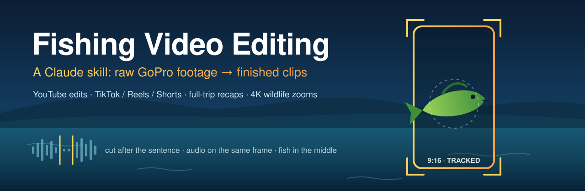
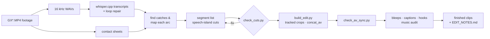

<p align="center">
  
</p>

<p align="center">
  <a href="https://github.com/pj4533/fishing-video-editing/actions/workflows/check.yml"></a>
  <a href="LICENSE"></a>
  <a href="https://agentskills.io"></a>
  <a href="https://code.claude.com/docs/en/plugins"></a>
  
  
</p>

<p align="center">
  <b>Point Claude at a folder of fishing footage. Get back finished clips.</b><br>
  YouTube edits · TikTok / Reels / Shorts catch features · full-trip recaps · 4K wildlife zooms
</p>

---

A day on the water produces hours of footage with a few minutes of real action in it. This skill teaches Claude to
work like an editor on that footage. It transcribes the audio, finds the bites, and maps each catch from hookset to
release. It cuts only after a finished sentence and keeps the fish centered with a tracker. Then it captions, bleeps
and checks the audio sync, and hands back videos you can post.

The rules came from many rounds of real feedback on real fishing edits: kayak bass trips, 1080p and 4K GoPro
footage. They're written down with the reason each one exists. It works for any angler, water or species: kayak, boat,
shore or ice; GoPro, DJI, Insta360 or phone.

## What it makes

| | Output | Shape | When |
|---|---|---|---|
| 🎬 | **Long-form edit** | 16:9 landscape | YouTube: intro → every catch's full arc, in order → outro |
| 📱 | **Catch features** | 9:16 portrait, 30–60 s | One per catch for TikTok, Reels or Shorts: the bite, the fight, the hold-up, the release |
| 🧵 | **Full-trip recap** | 9:16 portrait, 3–6 min | The whole day in one TikTok: cold open, `CATCH 1/3` counters, story beats, tally card |
| 🎙️ | **Talk clips** | 9:16 portrait | On-camera monologues, clipped whole |
| 🦅 | **Wildlife zooms** | 9:16 from 4K | "Zoom in on that eagle": a tracked virtual camera that keeps the animal big in frame |

## What it knows

- **Cuts that never chop words.** Cut points come from real speech boundaries, and every in and out point is checked
  with a voice-activity detector. Re-transcribing can't catch a chopped word, because whisper "hears" a clipped
  "fis-" as "fish".
- **Audio and picture locked together.** Audio is rebuilt sample-exact from the source and checked the way
  QuickTime and browsers actually play it. Concatenating per-segment AAC drifted by a second in real life.
- **The fish stays in the middle.** Hold-ups are tracked with a keyframe-anchored, bidirectional tracker. When the fish
  is wider than the portrait window, the crop biases toward the head and lets the tail clip, never the other way
  around.
- **Story craft for each platform.**
  - Hooks in the first 3 seconds.
  - Burned-in verbatim captions inside the TikTok safe zones.
  - Recap pacing: a payoff every 40–50 s, a beat every ~20 s.
  - YouTube retention structure and thumbnails.
- **What to leave out:** net fumbling, unhooking struggles, scale rigging, paddling, other people, and anything the
  angler says to the editor ("zoom in on that", "use this as the outro").
- **Audio finishing:**
  - Bleeps that land exactly on the word.
  - Wind filtering.
  - Detection and removal of background music (a wedding PA across the lake is a copyright strike waiting to happen).
- **Traps that waste hours:**
  - Whisper hallucination loops on quiet clips.
  - zsh word-splitting.
  - 4K frame sizes that fill a disk.
  - A lure skirt that a bird detector reads as legs.

## Install

### Claude Code (recommended): as a plugin

```bash
claude plugin marketplace add pj4533/fishing-video-editing
claude plugin install fishing-video-editing@fishing-video-editing
```

Or from inside a session:

```text
/plugin marketplace add pj4533/fishing-video-editing
/plugin install fishing-video-editing@fishing-video-editing
```

### Claude Code: as a plain skill

```bash
git clone https://github.com/pj4533/fishing-video-editing
cp -r fishing-video-editing/skills/fishing-video-editing ~/.claude/skills/
```

### Claude.ai, the API, and other agents

The skill follows the open [Agent Skills](https://agentskills.io) format: a folder with a `SKILL.md`, plus
`references/` and `scripts/`.
- **Claude.ai:** zip `skills/fishing-video-editing/` and upload it as a custom skill (see
  [Using skills in Claude](https://support.claude.com/en/articles/12512180-using-skills-in-claude)).
- **Claude API:** upload it through the [Skills API](https://docs.claude.com/en/api/skills-guide).
- **Other agents:** any agent that reads `SKILL.md` folders can use it as-is.

The editing scripts need a machine with ffmpeg and Python, so the skill is most useful where the agent can run shell
commands: Claude Code, or a Claude.ai session with code execution.

### Tools it uses

The skill walks you through installing these ([`references/setup.md`](skills/fishing-video-editing/references/setup.md)):
- `ffmpeg`;
- [`whisper.cpp`](https://github.com/ggerganov/whisper.cpp) (`brew install whisper-cpp`) with the `base.en` and
  `small.en` models;
- Python 3 with `numpy`, `opencv-python`, `webrtcvad`, `soundfile` and `Pillow`;
- optional: a demucs + transformers venv for the music check, and ultralytics/sahi for wildlife zooms.

It's built on macOS; Linux works with the documented overrides (`FFMPEG_HWACCEL`, `CAPTION_FONT`).

## Use it

Just describe what you want:

> "Here's today's footage: `~/Videos/lake_saturday`. Caught two bass and a pickerel. Make TikTok clips for each catch
> and a full-trip recap."

> "Edit `~/gopro/river_trip` into a YouTube video. Keep it calm, cut all the paddling."

> "There's a heron around the 20-minute mark of GX030042. Can you zoom in on it?"

Claude will:
1. inventory the clips;
2. transcribe them;
3. find the catches;
4. lay out each catch's arc with source timestamps;
5. build the edits and verify the cuts, sync and framing;
6. deliver the videos plus an `EDIT_NOTES.md` that lists every source in/out point, what it excluded, and what it left
   out for length, so you can ask for changes by timestamp.

## How it works



## What's inside

```text
skills/fishing-video-editing/
├── SKILL.md                    # the entry point: modes, non-negotiable rules, workflow
├── references/
│   ├── editing-rules.md        # every rule, with why it exists
│   ├── workflow.md             # step by step + EDIT_NOTES.md template
│   ├── cookbook.md             # exact ffmpeg/whisper commands, build JSON schema, fish centering
│   ├── portrait-shortform.md   # per-catch TikTok/Reels/Shorts features
│   ├── tiktok-longform.md      # 3–6 min full-trip recaps
│   ├── youtube-longform.md     # landscape long-form craft
│   ├── thumbnails-titles.md    # YouTube packaging
│   ├── wildlife-zoom.md        # 4K animal tracking clips
│   ├── setup.md                # installing everything
│   └── lessons-learned.md      # the traps
└── scripts/
    ├── build_edit.py           # one JSON per edit → encoded, assembled, sync-checked
    ├── check_cuts.py           # voice-activity check of every cut (--fix)
    ├── concat_av.py            # sample-exact audio assembly
    ├── check_av_sync.py        # sync check the way real players play it
    ├── fishtrack2.py           # keyframe-anchored bidirectional fish tracker
    ├── burn_captions.py        # captions + hook/counter text
    ├── speech_islands.py       # real speech boundaries
    ├── transcribe_islands.py   # per-phrase transcripts for cuts and captions
    ├── keyframe_grid.sh        # grid frames for reading tracker boxes
    ├── music_audit.py          # background-music detection (demucs)
    ├── music_ast_check.py      # AudioSet "Music" second opinion
    ├── voice_isolate.py        # swap in the voice stem where music bleeds in
    ├── make_thumbnail.py       # YouTube thumbnail recipe
    └── wildlife_*.py           # find / track / reframe animals in 4K
```

## Contributing

Issues and pull requests are welcome, especially:
- footage from other cameras;
- other species and setups (shore, ice, fly);
- Linux and Windows fixes.

Please keep the skill generic. Anything specific to one angler or one body of water belongs in your own notes, not in
the skill.

## Privacy

Everything runs locally; the skill collects and sends no data. See [PRIVACY.md](PRIVACY.md).

## License

[MIT](LICENSE) © PJ Gray
